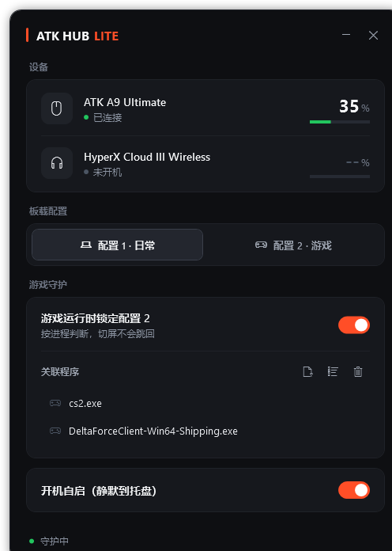
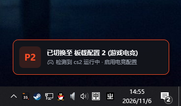
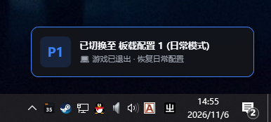

# ATKLiteHub

轻量、极简且高效的鼠标外设硬件控制与场景配置文件自动切换工具。基于 .NET 8 与原生 WPF 开发，彻底去除官方驱动动辄数百兆的内嵌网页后台与多余常驻服务，即开即用、内存极低。

<div align="center">
  
</div>

---

## ✨ 核心特性

- **轻量低占用**：纯原生 WPF + .NET 8 构建，去除臃肿的 Electron/CEF 网页驱动外壳，后台静默内存仅数兆。
- **进程感知与配置自适应**：
  - 自由绑定多个游戏/应用程序进程（如 `cs2.exe`、`DeltaForceClient-Win64-Shipping.exe` 等）。
  - **启动指定游戏**：自动下发底层指令切换至板载 **配置 2（游戏电竞高回报率）**。
  - **游戏退出后**：自动恢复至板载 **配置 1（日常节能低回报率）**。
- **动态悬浮无感提示**：在屏幕右下角弹出精致的无焦点动画 Toast 提示，切屏不卡顿、不抢游戏焦点。
- **托盘状态与电量显示**：支持最小化至系统托盘，托盘动态生成低电量红字提示，支持开机自启动。
- **免安装绿色发布**：提供预编译独立版本，无需安装任何依赖，解压即用。

---

## 📸 运行效果演示

### 自动配置切换与屏幕 Toast 提示

<div align="center">
  
  &nbsp;&nbsp;
  
</div>

- **进入游戏**：检测到目标进程启动，瞬时切换为游戏电竞配置。
- **退出游戏**：检测到进程关闭，瞬间恢复日常节能模式。

---

## 🔍 如何验证 Lite 驱动是否生效？

进入游戏后，鼠标配置（如回报率、DPI）是否真的生效了？您可以使用以下在线工具进行实时验证：

👉 **[在线鼠标回报率检测工具 (Polling Rate Test)](https://webcammictest.com/zh/mouse/polling-rate/)**

- **测试方法**：
  1. 日常状态下打开网页并在测试区域划动鼠标，观察当前回报率（例如日常配置设定的 1000Hz）；
  2. 启动您关联的游戏（或在关联程序中加入浏览器进程测试），再次划动鼠标，观察回报率是否自动提升（例如设定的 4000Hz / 8000Hz）；
  3. 退出游戏后再次测试，确认是否无缝回落。

---

## 🛠️ 设备适配指南：如何用 AI Agent 改造成你自己的驱动？

> [!NOTE]
> 本项目的原始代码是作者为自己的外设组合（**ATK A9 Ultimate 鼠标** + **HyperX Cloud III Wireless 旋风3 无线耳机**）量身逆向和定制的。
>
> 如果您的鼠标或耳机是其他品牌/型号（例如雷蛇、罗技、VGN、漫步者等），直接运行将无法识别。但**本项目已经搭建好完整的原生 Windows HID 通信底层、托盘生命周期与进程监听骨架**，您可以直接将本项目源码丢给 AI 编程助手（如 **Cursor / Claude / Antigravity / ChatGPT**），让 AI 协助完成适配！

### 核心需要修改的代码位置：[`HardwareService.cs`](./HardwareService.cs)

让 AI Agent 帮你修改时，只需关注以下 3 个模块：

1. **设备枚举与识别（VID / PID 过滤）**
   - **鼠标**：修改 `RefreshDevicesIfNeeded()` 中的 `d.Vid`、`d.UsagePage` 与 `d.Usage`。
   - **耳机**：修改 `d.Vid == 0x03F0` 及 `d.Pid`，换成你自己耳机的厂商与产品 ID（可在 Windows **设备管理器 -> 人体学输入设备 -> 属性 -> 硬件 ID** 中查看）。

2. **鼠标配置查询与切换报文**
   - **修改方法**：`QueryMouseProfile()` 与 `SetMouseProfile()`。
   - **逻辑**：替换其中的 HID Feature/Output Report 字节包与校验和（Checksum）逻辑，适配你鼠标的板载协议。

3. **耳机电量读取报文**
   - **修改方法**：`QueryHeadsetBattery()`。
   - **逻辑**：替换为你耳机品牌的原始 HID 查询指令，并解析返回数据包中的电量百分比字节。

---

### 💬 推荐直接发给 AI Agent 的适配 Prompt 模板：

```text
你好！我正在基于 GitHub 项目 ATKLiteHub (C# .NET 8 WPF) 进行二次开发。
该项目通过 Windows 原始 HID API (HardwareService.cs) 实现了免官方驱动的外设电量读取与板载 Profile 切换。

我现在的外设是：
- 鼠标型号：[填写你的鼠标型号，如：VGN F1 Pro] (VID: 0xXXXX, PID: 0xXXXX)
- 耳机型号：[填写你的耳机型号，如：罗技 G Pro X Wireless] (VID: 0xXXXX, PID: 0xXXXX)

请帮我阅读并修改 HardwareService.cs：
1. 将设备枚举过滤条件更新为我上述外设的 VID/PID；
2. 如果已知该设备的 HID 通信协议/报文格式，请按对应协议改写 QueryMouseProfile、SetMouseProfile 和 QueryHeadsetBattery；
3. 如果未连接耳机，请保证界面优雅降级隐藏，只保留鼠标控制。
```

---

## 📁 目录结构

```text
ATKLiteHub/
├── publish/                   # 预编译绿色免安装包（解压/下载即用）
│   ├── ATKLiteHub.exe        # 启动程序
│   └── ...
├── App.xaml / App.xaml.cs    # 应用程序生命周期与单例控制
├── MainWindow.xaml (.cs)     # 主界面交互与控制面板
├── HardwareService.cs        # 硬件通信与底层指令控制（重点适配文件）
├── ProcessMonitorService.cs  # 进程前台监听与自动感知
├── ProfileToastWindow.xaml   # 切换配置浮动提示框
├── StartupHelper.cs          # 开机自启配置
├── TrayIconHelper.cs         # 系统托盘管理
├── screenshot.png            # 界面预览截图
├── toast_game.png            # 游戏切换 Toast 演示图
├── toast_normal.png          # 日常切换 Toast 演示图
└── ATKLiteHub.csproj         # 项目工程文件 (.NET 8.0-windows)
```

---

## 🚀 快速开始

### 方式 1：直接运行免安装包
进入项目根目录下的 [`publish/`](./publish/) 目录，直接双击运行 `ATKLiteHub.exe` 即可。

### 方式 2：通过源码编译

1. 确保安装了 [.NET 8 SDK](https://dotnet.microsoft.com/download/dotnet/8.0)。
2. 克隆本仓库：
   ```bash
   git clone https://github.com/StarCenzZ/ATKLiteHub.git
   cd ATKLiteHub
   ```
3. 运行或构建项目：
   ```bash
   # 运行
   dotnet run

   # 发布绿色独立版
   dotnet publish -c Release -o ./publish
   ```

---

## 👥 作者与协作 (Authors & Credits)

- **StarCenzZ** ([@StarCenzZ](https://github.com/StarCenzZ)) - 项目发起、需求架构与设备真机调试
- **Claude (Anthropic)** - 参与早期架构设计与核心业务逻辑构建
- **Gemini (Google DeepMind)** - 参与底层 HID 协议分析、WPF 界面渲染、工程化完善与发布

> 💡 本项目由 **StarCenzZ** 主导发起，并先后在 **Claude** 与 **Gemini** 的多 AI 结对编程协作下共同开发打造。

---

## 📄 开源许可

本项目基于 [MIT 许可证](./LICENSE) 开源。
